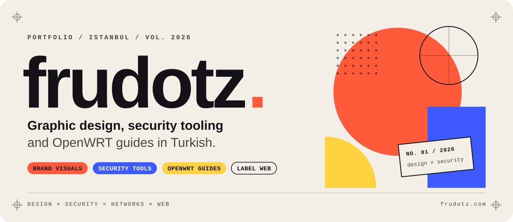
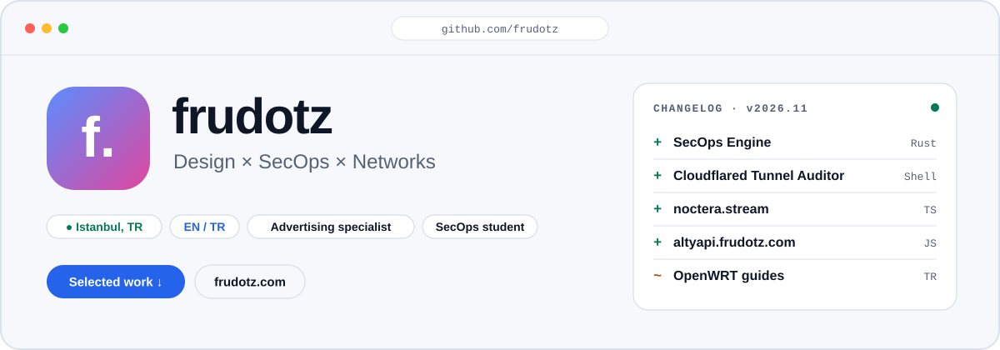

# README options: frudotz

Preview drafts only. The live profile README (`readme.md`) is unchanged. Each option is a full visual redesign with its own original, repo-hosted SVG artwork in [`assets/`](assets/).

<table>
  <tr>
    <td width="33%" valign="top">
      
      <h3><a href="README-option-a-editorial.md">A · Studio</a></h3>
      English · art-directed portfolio · poster cards for each project, theme-aware hero and timeline · no third-party images
    </td>
    <td width="33%" valign="top">
      
      <h3><a href="README-option-b-gece-vardiyasi.md">B · Gece Vardiyası</a></h3>
      Türkçe · cyber-gece ve müzik · kaset setlist, mikser kanalları, NOCTERA plak kartı · üçüncü taraf görsel yok
    </td>
    <td width="33%" valign="top">
      
      <h3><a href="README-option-c-dashboard-bilingual.md">C · Dashboard bilingual</a></h3>
      English + Türkçe · modern product/dashboard · bento overview, deployments board, live shields.io status pills, skillicons strip
    </td>
  </tr>
</table>

| | A · Studio | B · Gece Vardiyası | C · Dashboard bilingual |
| :-- | :-- | :-- | :-- |
| Light/dark | `<picture>` hero + timeline; colour-block cards | self-contained night panels | `<picture>` for every SVG |
| External hosts | none | none | shields.io, skillicons.dev (both HTTP 200 on 2026-11-15) |
| Motion | none | cursor + waveform, under 5 s, off with reduced motion | none |

`[[CONFIRM: ...]]` markers are intentional: display name, NOCTERA role, music involvement, design tools and availability still need your answer before any option replaces `readme.md`. Pick one option or mix sections (for example A's cards with C's status board).
