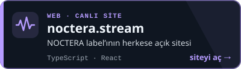
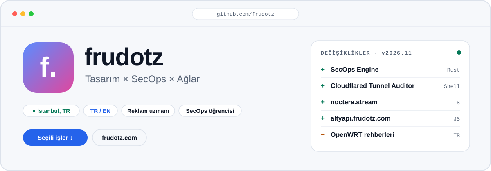

# README seçenekleri: frudotz

Yalnızca önizleme taslaklarıdır; canlı profil README'si (`readme.md`) değişmedi. Her seçenek, [`assets/`](assets/) altındaki özgün, repoda barındırılan SVG görselleriyle tam bir görsel tasarımdır. **Ana sürümler Türkçe**; İngilizce sürümler aynı olguları taşıyan **yedeklerdir**.

## Önerilen yön: D · Profil özeti

  

🇹🇷 <a href="README-option-d-profile-summary-tr.md"><b>Türkçe (ana)</b></a> · 🇬🇧 <a href="README-option-d-profile-summary-en.md">English (yedek)</a>

Tek sayfalık, Türkçe öncelikli bir profil. Bilgi mimarisi dört adımda okunuyor:

1. **Kim:** sade bir başlık, bağlantılar ve tek cümlelik konumlandırma; ardından tasarım, güvenlik, ağ ve müzik için web kesişimini anlatan iki cümlelik özet.
2. **Ne yapıyor:** dört yetkinlik grubu (Güvenlik, Ağ, Web, Tasarım ve iletişim). Her grupta "üretiyorum / yayında / öğreniyorum" gibi kanıta bağlı fiiller ve birkaç teknoloji etiketi var; "uzman" ya da yüzde/seviye çubuğu yok.
3. **Nereye tıklamalı:** üç kategoride ikişer, toplam altı görselli buton. Her biri bir repoya ya da canlı siteye giden `<a>` içinde açıklayıcı alt metinli, repoda barındırılan özgün bir SVG. Butonlar kendi koyu panelinde, hem açık hem koyu temada okunuyor, üzerine gelmeye bağlı değil; masaüstünde ikişer yan yana, mobilde tek sütun.
4. **Arka plan:** öğrenim, genel ifadeli deneyim ve eğitimler için kısa bir tablo; tam CV zaman çizelgesi, istatistik kartı ya da hareketli bileşen yok.

İlham, bilgi mimarisi düzeyinde alındı (kısa özet → gruplu yetkinlikler → görselli, tıklanabilir proje kartları); metin, görsel ve varlıklar özgün. Dış sunucu, font ya da script kullanılmıyor.

## Alternatifler (korunuyor)

<table>
  <tr>
    <td width="33%" valign="top">
      
      <h3><a href="README-option-a-studio-tr.md">A · Stüdyo</a></h3>
      Editoryal portfolyo · her proje için afiş kartı, temaya duyarlı başlık ve zaman çizelgesi · üçüncü taraf görsel yok 
      🇹🇷 <a href="README-option-a-studio-tr.md"><b>Türkçe (ana)</b></a> · 🇬🇧 <a href="README-option-a-studio-en.md">English (yedek)</a>
    </td>
    <td width="33%" valign="top">
      
      <h3><a href="README-option-b-gece-vardiyasi-tr.md">B · Gece Vardiyası</a></h3>
      Cyber-gece ve müzik · kaset setlist, mikser kanalları, NOCTERA plak kartı · üçüncü taraf görsel yok 
      🇹🇷 <a href="README-option-b-gece-vardiyasi-tr.md"><b>Türkçe (ana)</b></a> · 🇬🇧 <a href="README-option-b-gece-vardiyasi-en.md">English (yedek, "Night Shift")</a>
    </td>
    <td width="33%" valign="top">
      
      <h3><a href="README-option-c-dashboard-tr.md">C · Dashboard</a></h3>
      Modern ürün paneli, iki dilli · bento özet, yayın panosu, canlı shields.io durum rozetleri, skillicons şeridi 
      🇹🇷 <a href="README-option-c-dashboard-tr.md"><b>Türkçe öncelikli (ana)</b></a> · 🇬🇧 <a href="README-option-c-dashboard-en.md">English + Türkçe (yedek)</a>
    </td>
  </tr>
</table>

## Dosyalar ve diller

| Seçenek | Türkçe (ana) | İngilizce (yedek) | Görseller |
| :-- | :-- | :-- | :-- |
| **D · Profil özeti (önerilen)** | [`README-option-d-profile-summary-tr.md`](README-option-d-profile-summary-tr.md) | [`README-option-d-profile-summary-en.md`](README-option-d-profile-summary-en.md) | `assets/d-profile/*-tr.svg` (TR) · `*-en.svg` (EN) |
| A · Stüdyo | [`README-option-a-studio-tr.md`](README-option-a-studio-tr.md) | [`README-option-a-studio-en.md`](README-option-a-studio-en.md) | `assets/a-studio/*-tr.svg` (TR) · `*.svg` (EN) |
| B · Gece Vardiyası | [`README-option-b-gece-vardiyasi-tr.md`](README-option-b-gece-vardiyasi-tr.md) | [`README-option-b-gece-vardiyasi-en.md`](README-option-b-gece-vardiyasi-en.md) | `assets/b-gece/*.svg` (TR) · `*-en.svg` (EN) · ayırıcı ortak |
| C · Dashboard | [`README-option-c-dashboard-tr.md`](README-option-c-dashboard-tr.md) (Türkçe üstte, kısa İngilizce özet katlanır bölümde) | [`README-option-c-dashboard-en.md`](README-option-c-dashboard-en.md) (İngilizce üstte, tam Türkçe katlanır bölümde) | `assets/c-dashboard/*-tr.svg` (TR) · `*.svg` (EN) |

Her dosyanın sağ üstünde dil geçiş bağlantısı var. Olgular ve `[[CONFIRM: ...]]` işaretleri her iki dilde aynıdır.

## Karşılaştırma

| | D · Profil özeti | A · Stüdyo | B · Gece Vardiyası | C · Dashboard |
| :-- | :-- | :-- | :-- | :-- |
| Öne çıkan kimlik | Dengeli, kısa: tasarım, güvenlik, ağ, müzik için web | Tasarım ve portfolyo | Siber güvenlik gecesi + müzik | Dengeli: tasarım, güvenlik, ağ, web |
| En iyi hedef kitle | Karma kitle; 10–30 saniyede taranacak profil | Tasarım/ajans, yaratıcı roller | Topluluk, müzik çevresi, kişilik odaklı ziyaretçi | İşe alım yapanlar, teknik ekipler, karma kitle |
| Kanıt gösterimi | Kategorili 6 görselli buton + kaynak satırı | Proje kartları (bağlantılı) | Setlist + kaynak bağlantıları | Yayın panosu + canlı durum rozetleri + proje tablosu |
| Müziğe verdiği ağırlık | Düşük (bir buton, "müzik için web") | Düşük (bir kart + bir sütun) | Yüksek (ayrı "B tarafı") | Düşük (bir satır) |
| Açık/koyu tema | Başlık `<picture>`; butonlar kendi koyu panelinde | Başlık ve zaman çizelgesi `<picture>`; kartlar kendi renk bloğunda | Kendi koyu panelleri (temayla değişmez) | Her SVG için `<picture>` |
| Dış sunucular | Yok | Yok | Yok | shields.io, skillicons.dev (2026-11-15'te HTTP 200) |
| Hareket | Yok | Yok | İmleç + dalga, 5 sn'den kısa, "hareketi azalt" tercihinde kapalı | Yok |
| Bağımlı olduğu onaylar | Görünen ad, tasarım araçları, kurum adı/unvan görünürlüğü | Görünen ad, tasarım araçları | **NOCTERA rolü ve müzik katılımı** (konsept buna dayanıyor) | Görünen ad, kurum adı/unvan görünürlüğü |

### Öneri (karar senin)

**D · Profil özeti (Türkçe)** artık önerilen yön: C'nin dengesini korurken daha kısa, daha kişisel ve daha "tıklanabilir". Ziyaretçi önce kim olduğunu, sonra neyi kanıtla ürettiğini, en son da hangi repoya gideceğini görüyor. Dış sunucuya bağımlı değil ve NOCTERA rolü netleşmeden müziğe aşırı ağırlık vermiyor. Zayıf yanı, A ve B kadar güçlü bir sanat yönetmenliği iddiası taşımaması.

- Daha ürün paneli gibi, canlı durum rozetli bir görünüm istenirse **C**.
- Tasarım/ajans tarafı öncelikliyse **A** daha güçlü bir ilk izlenim bırakır.
- NOCTERA'da yaratıcı bir rolün varsa ya da kendin müzik üretiyorsan **B** en özgün olanıdır; rol netleşmeden B'nin "B tarafı" anlatısı fazla iddialı kalabilir.
- Karma da mümkün: örneğin D'nin iskeleti + A'nın afiş kartları.

## NOCTERA ve iş deneyimi: profilde nasıl görünmeli?

Kısa gerekçe (ayrıntılı değerlendirme yayımlanmayan yerel çalışma notlarında tutuluyor):

- **Profil README'si bir CV değil**, kısa bir açılış sayfası: yalnızca doğrulanabilir, güncel ve kimliğe uyan işler öne çıkmalı.
- **NOCTERA:** Herkese açık site (noctera.stream) ve kaynak kodu reposu doğrulanabilir bir kanıt; yalnızca "bağımsız label NOCTERA'nın herkese açık sitesi + kaynak kodu" çerçevesiyle gösterilmesi öneriliyor. Rolün (kurucu, tasarım, A&R vb.) ve müzik katılımın doğrulanmadan label adına konuşan ya da "label'ım" diyen bir ifade, logo veya sürüm başarısı kullanılmamalı.
- **İş deneyimi (reklam):** Önizlemeler varsayılan olarak gizlilik dostu: kurum adı ve unvan yazılmadı, yalnızca "2021'den beri reklam, topluluk ve marka iletişimi deneyimi" ifadesi kullanıldı. Kurum adı ve unvan, yalnızca yayımlama izni netleşirse tek satır olarak, logo ve iç bilgi olmadan eklenebilir; aksi hâlde genel ifade kalır ya da ayrıntı LinkedIn/site'ye bırakılır.
- Öneri, rolüne ve kurumların açıklama iznine göre değişebilir.

## Onay bekleyenler

`[[CONFIRM: ...]]` işaretleri bilinçli olarak görünür bırakıldı: görünen ad, NOCTERA'daki rol, müzik katılımı, tasarım araçları, uygunluk cümlesi ve **kurum adı/unvanın yayımlanıp yayımlanamayacağı**. Herhangi bir seçenek `readme.md` yerine geçmeden önce bunların yanıtlanması gerekiyor. Görseller de genel ifadeyi kullanıyor; izin gelirse yeniden üretilebilir.

<samp>English summary</samp>

Preview drafts only; the live `readme.md` is unchanged. **Option D · Profile summary** ([TR, primary](README-option-d-profile-summary-tr.md) · [EN, backup](README-option-d-profile-summary-en.md)) is now the recommended direction: a single Turkish-first page that reads in four steps: who (plain header, links, one-sentence positioning and a two-sentence summary), what (four capability groups with evidence-based verbs such as building, live and learning, never skill levels), where to click (six original, repo-hosted SVG buttons in three categories, each an `<a>` to a public repository or live site with descriptive alt text), and a compact background table. The structure is inspired by a reference profile's information architecture only; wording and artwork are original, and there are no external hosts, fonts or scripts. The earlier options remain as alternatives: A Studio ([TR](README-option-a-studio-tr.md) · [EN](README-option-a-studio-en.md)), B Gece Vardiyası / Night Shift ([TR](README-option-b-gece-vardiyasi-tr.md) · [EN](README-option-b-gece-vardiyasi-en.md)), C Dashboard ([TR-first](README-option-c-dashboard-tr.md) · [EN + TR](README-option-c-dashboard-en.md)). Visible `[[CONFIRM: ...]]` markers (display name, NOCTERA role, music involvement, design tools, availability, whether an organisation name/title may be published) must be resolved before any option replaces `readme.md`.

