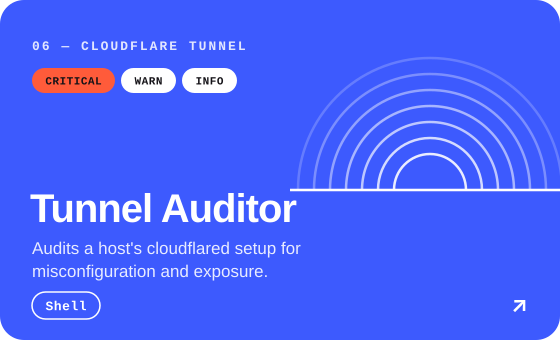
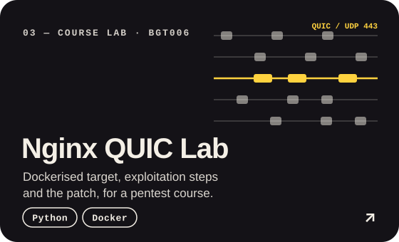
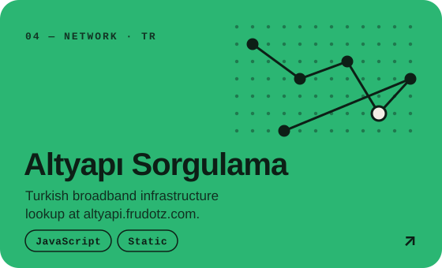
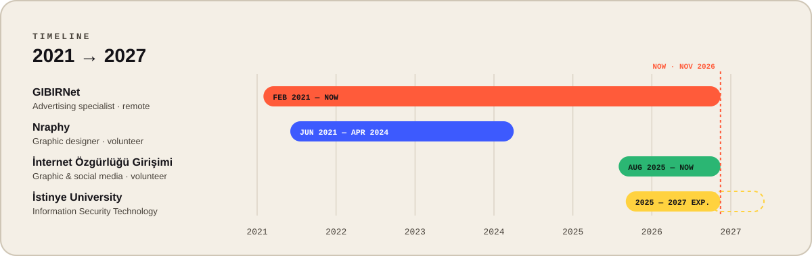

<!--
  OPTION A: "Studio" — art-directed portfolio. ENGLISH BACKUP.
  Turkish-first version: README-option-a-studio-tr.md (same facts, Turkish artwork in *-tr.svg).
  All artwork is original SVG hosted in ./assets/a-studio (no third-party hosts).
  Resolve every [[CONFIRM: ...]] marker before this replaces readme.md.
-->

<a href="README-option-a-studio-tr.md">Türkçe</a> · <b>English</b>

<a href="https://frudotz.com">
  <picture>
    <source media="(prefers-color-scheme: dark)" srcset="./assets/a-studio/hero-dark.svg">
    <source media="(prefers-color-scheme: light)" srcset="./assets/a-studio/hero-light.svg">
    
  </picture>
</a>

  <b>frudotz</b> · [[CONFIRM: display name]] · Istanbul 
  <a href="https://frudotz.com">frudotz.com</a> ·
  <a href="https://www.behance.net/frudotz">Behance</a> ·
  <a href="https://www.linkedin.com/in/frudotz/">LinkedIn</a> ·
  <a href="https://www.instagram.com/frudotz/">Instagram</a> ·
  <a href="https://noctera.stream">NOCTERA</a>

## Selected work

<table>
  <tr>
    <td width="50%"></td>
    <td width="50%"></td>
  </tr>
  <tr>
    <td width="50%"></td>
    <td width="50%"></td>
  </tr>
  <tr>
    <td width="50%"></td>
    <td width="50%"></td>
  </tr>
</table>

Source: <a href="https://github.com/frudotz/net-infra-query">altyapi</a> · <a href="https://github.com/frudotz/steam-cs2-analytics">cs2</a> · <a href="https://github.com/frudotz/noctera-stream">noctera-stream</a> · Guides: <a href="https://github.com/frudotz/openwrt-xiaomi-4a-gigabit">4A Gigabit</a> · <a href="https://github.com/frudotz/openwrt-xiaomi-ax3200">AX3200</a> · <a href="https://github.com/frudotz/debrick-xiaomi-ax3200">AX3200 debrick</a> · <a href="https://github.com/frudotz/openwrt-zyxel-nbg7815">NBG7815</a> · <a href="https://github.com/frudotz/openwrt-sqm">SQM</a> · <a href="https://github.com/frudotz/openwrt-cloudflare-tunnel">Cloudflare Tunnel</a> · <a href="https://github.com/frudotz/openwrt-dsl-bridge-wizard">DSL bridge</a> · <a href="https://github.com/frudotz/openwrt-wol-automation">Wake-on-LAN</a>

## Practice

| Design & advertising | Security & networks | Music |
| :-- | :-- | :-- |
| Advertising, community and brand communications experience since 2021 [[CONFIRM: may the organisation name and your title be published?]]; volunteer design for Nraphy and İnternet Özgürlüğü Girişimi. | Information Security Technology at İstinye University; HTTP, tunnel and router tooling. | Public site and source code for the label NOCTERA (noctera.stream). [[CONFIRM: your role at NOCTERA]] · [[CONFIRM: do you make or perform music yourself?]] |

**Toolbox** `Rust` `Python` `TypeScript` `Shell` `Linux` `OpenWRT` `Docker` `Cloudflare` · [[CONFIRM: design tools, e.g. Photoshop / Illustrator / Figma]]

## Timeline

<picture>
  <source media="(prefers-color-scheme: dark)" srcset="./assets/a-studio/timeline-dark.svg">
  <source media="(prefers-color-scheme: light)" srcset="./assets/a-studio/timeline-light.svg">
  
</picture>

Selected training

- TryHackMe learning paths: Jr Penetration Tester, CompTIA Pentest+ <i>path</i>, Complete Beginner, Pre Security, Web Fundamentals
- Cisco Networking Academy: Introduction to Cybersecurity
- BTK Akademi: Network Fundamentals, IPv6 Transition
- TEKNOFEST SiberVatan AyaküstüCTF: participant

[[CONFIRM: availability wording, e.g. "Open to design, campaign and junior security roles"]]
