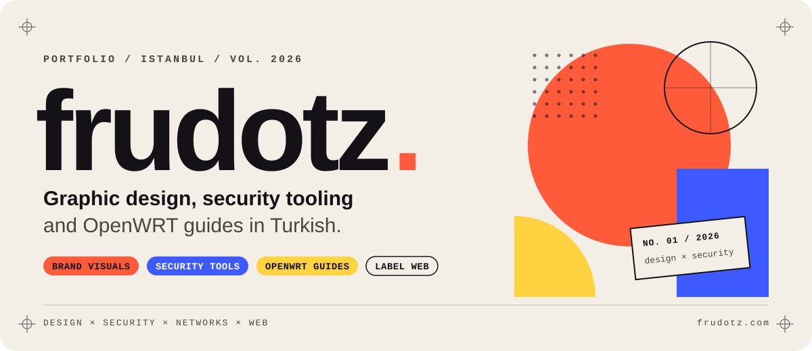
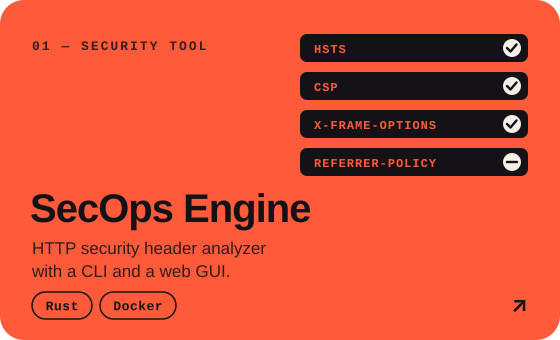
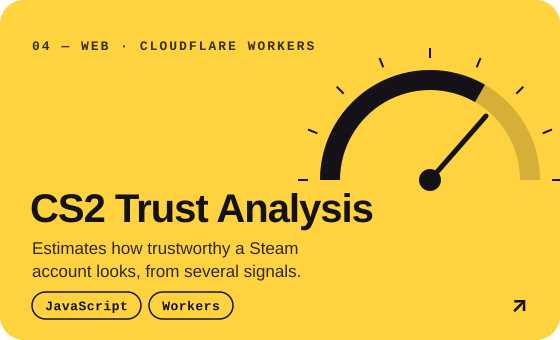
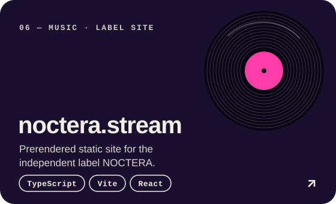
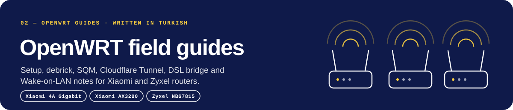
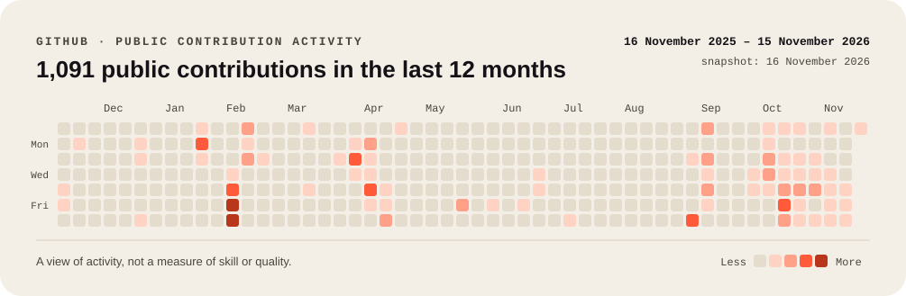

<!--
  OPTION A: "Studio" — RECOMMENDED / CURRENT DIRECTION. ENGLISH BACKUP.
  Turkish-first version: README-option-a-studio-tr.md (same facts, Turkish artwork in *-tr.svg).
  A short profile landing, not a CV: identity summary → tool summary → one poster card per project.
  The project section is based only on public GitHub repositories; every card links straight to its repo.
  All artwork is original SVG hosted in ./assets/a-studio (no third-party hosts, fonts or scripts).
  Resolve every [[CONFIRM: ...]] marker before this replaces readme.md.
-->

<a href="README-option-a-studio-tr.md">Türkçe</a> · <b>English</b>

<a href="https://frudotz.com">
  <picture>
    <source media="(prefers-color-scheme: dark)" srcset="./assets/a-studio/hero-dark.svg">
    <source media="(prefers-color-scheme: light)" srcset="./assets/a-studio/hero-light.svg">
    
  </picture>
</a>

  <b>frudotz</b> · [[CONFIRM: display name]] · Istanbul 
  <a href="https://frudotz.com">frudotz.com</a> ·
  <a href="https://github.com/frudotz?tab=repositories">GitHub repositories</a> ·
  <a href="https://www.behance.net/frudotz">Behance</a> ·
  <a href="https://www.linkedin.com/in/frudotz/">LinkedIn</a> ·
  <a href="https://www.instagram.com/frudotz/">Instagram</a>

**I build security and network tooling with a designer's eye.** Small tools that audit HTTP headers and tunnel configurations, OpenWRT guides written in Turkish and a few web projects, all in the public GitHub repositories below.

**Tools** `Rust` `Python` `Shell` `JavaScript` `TypeScript` `React` `Vite` `Docker` `Cloudflare Workers` `Cloudflare Tunnel` `OpenWRT` `Linux`

## What I'm working on

Every card opens its GitHub repository.

<table>
  <tr>
    <td width="50%"></td>
    <td width="50%"></td>
  </tr>
  <tr>
    <td width="50%"></td>
    <td width="50%"></td>
  </tr>
  <tr>
    <td width="50%"></td>
    <td width="50%"></td>
  </tr>
</table>

OpenWRT guide repositories: <a href="https://github.com/frudotz/openwrt-xiaomi-4a-gigabit">4A Gigabit</a> · <a href="https://github.com/frudotz/openwrt-xiaomi-ax3200">AX3200</a> · <a href="https://github.com/frudotz/debrick-xiaomi-ax3200">AX3200 debrick</a> · <a href="https://github.com/frudotz/openwrt-zyxel-nbg7815">NBG7815</a> · <a href="https://github.com/frudotz/openwrt-sqm">SQM</a> · <a href="https://github.com/frudotz/openwrt-cloudflare-tunnel">Cloudflare Tunnel</a> · <a href="https://github.com/frudotz/openwrt-dsl-bridge-wizard">DSL bridge</a> · <a href="https://github.com/frudotz/openwrt-wol-automation">Wake-on-LAN</a>

## Contribution activity

<picture>
  <source media="(prefers-color-scheme: dark)" srcset="./assets/a-studio/contrib-dark.svg">
  <source media="(prefers-color-scheme: light)" srcset="./assets/a-studio/contrib-light.svg">
  
</picture>

Source: the public contribution calendar on the <a href="https://github.com/frudotz">GitHub profile</a>, captured 16 November 2026. The image is local and original; it does not update automatically.
