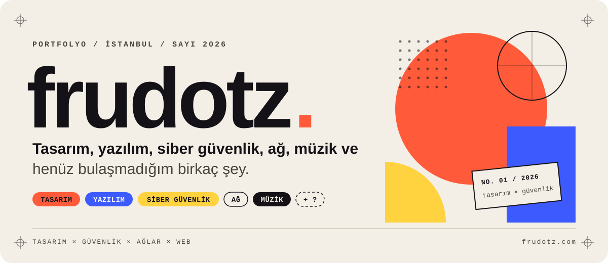
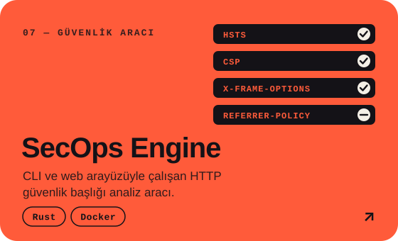
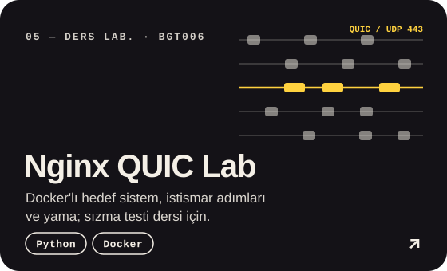
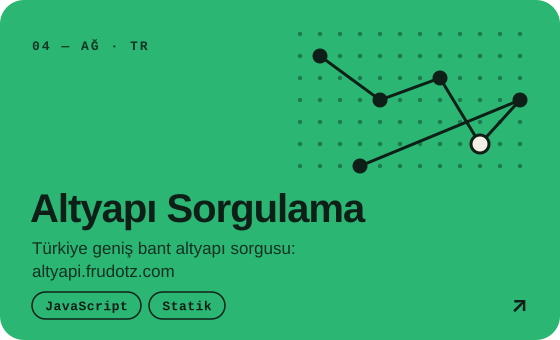
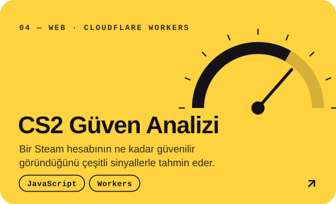
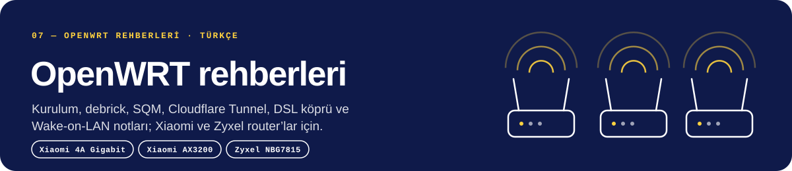
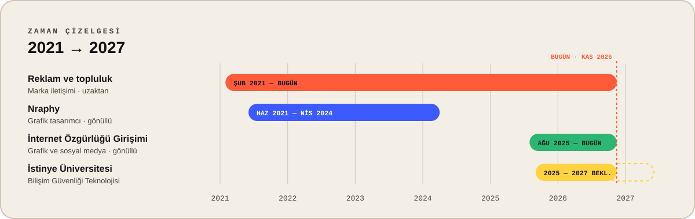

<!--
  SEÇENEK A: "Stüdyo" — sanat yönetmenliği yapılmış portfolyo. TÜRKÇE (ana sürüm).
  İngilizce yedek: README-option-a-studio-en.md (aynı olgular, İngilizce görseller).
  Tüm görseller ./assets/a-studio altındaki özgün SVG'lerdir (*-tr.svg); dış sunucu, font ya da script yok.
  [[CONFIRM: ...]] işaretleri çözülmeden readme.md yerine konmamalı.
-->

<b>Türkçe</b> · <a href="README-option-a-studio-en.md">English</a>

<a href="https://frudotz.com">
  <picture>
    <source media="(prefers-color-scheme: dark)" srcset="./assets/a-studio/hero-dark-tr.svg">
    <source media="(prefers-color-scheme: light)" srcset="./assets/a-studio/hero-light-tr.svg">
    
  </picture>
</a>

  <b>frudotz</b> · [[CONFIRM: görünen ad]] · İstanbul 
  <a href="https://frudotz.com">frudotz.com</a> ·
  <a href="https://www.behance.net/frudotz">Behance</a> ·
  <a href="https://www.linkedin.com/in/frudotz/">LinkedIn</a> ·
  <a href="https://www.instagram.com/frudotz/">Instagram</a> ·
  <a href="https://noctera.stream">NOCTERA</a>

## Seçili işler

<table>
  <tr>
    <td width="50%"></td>
    <td width="50%"></td>
  </tr>
  <tr>
    <td width="50%"></td>
    <td width="50%"></td>
  </tr>
  <tr>
    <td width="50%"></td>
    <td width="50%"></td>
  </tr>
</table>

Kaynak kod: <a href="https://github.com/frudotz/net-infra-query">altyapi</a> · <a href="https://github.com/frudotz/steam-cs2-analytics">cs2</a> · <a href="https://github.com/frudotz/noctera-stream">noctera-stream</a> · Rehberler: <a href="https://github.com/frudotz/openwrt-xiaomi-4a-gigabit">4A Gigabit</a> · <a href="https://github.com/frudotz/openwrt-xiaomi-ax3200">AX3200</a> · <a href="https://github.com/frudotz/debrick-xiaomi-ax3200">AX3200 debrick</a> · <a href="https://github.com/frudotz/openwrt-zyxel-nbg7815">NBG7815</a> · <a href="https://github.com/frudotz/openwrt-sqm">SQM</a> · <a href="https://github.com/frudotz/openwrt-cloudflare-tunnel">Cloudflare Tunnel</a> · <a href="https://github.com/frudotz/openwrt-dsl-bridge-wizard">DSL köprü</a> · <a href="https://github.com/frudotz/openwrt-wol-automation">Wake-on-LAN</a>

## Çalışma alanları

| Tasarım ve reklam | Güvenlik ve ağ | Müzik |
| :-- | :-- | :-- |
| 2021'den beri reklam, topluluk ve marka iletişimi deneyimi [[CONFIRM: kurum adı ve unvan herkese açık yazılabilir mi?]]; Nraphy ve İnternet Özgürlüğü Girişimi için gönüllü tasarım. | İstinye Üniversitesi'nde Bilişim Güvenliği Teknolojisi; HTTP, tünel ve router araçları. | NOCTERA label'ının herkese açık sitesi ve kaynak kodu (noctera.stream). [[CONFIRM: NOCTERA'daki rolün]] · [[CONFIRM: kendin müzik üretiyor veya icra ediyor musun?]] |

**Araç kutusu** `Rust` `Python` `TypeScript` `Shell` `Linux` `OpenWRT` `Docker` `Cloudflare` · [[CONFIRM: tasarım araçları, ör. Photoshop / Illustrator / Figma]]

## Zaman çizelgesi

<picture>
  <source media="(prefers-color-scheme: dark)" srcset="./assets/a-studio/timeline-dark-tr.svg">
  <source media="(prefers-color-scheme: light)" srcset="./assets/a-studio/timeline-light-tr.svg">
  
</picture>

Seçili eğitimler

- TryHackMe öğrenme yolları: Jr Penetration Tester, CompTIA Pentest+ <i>yolu</i>, Complete Beginner, Pre Security, Web Fundamentals
- Cisco Networking Academy: Introduction to Cybersecurity
- BTK Akademi: Ağ Temelleri, IPV6 Teknoloji Dönüşüm İhtiyaçları ve Çalışmaları
- TEKNOFEST SiberVatan AyaküstüCTF: katılımcı

[[CONFIRM: uygunluk cümlesi, ör. "Tasarım, kampanya ve junior güvenlik rollerine açığım"]]
