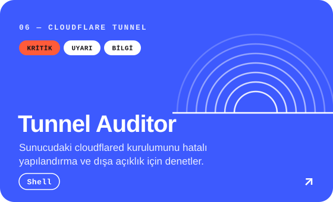
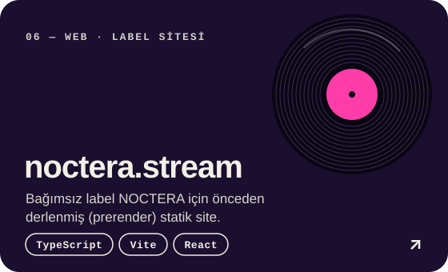
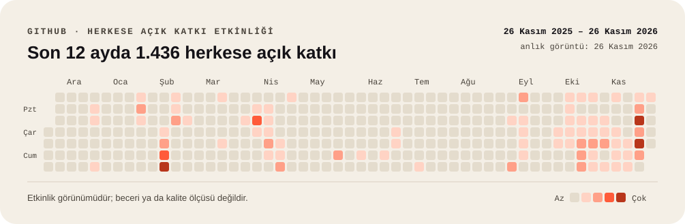

<!--
  SEÇENEK A: "Stüdyo" — ÖNERİLEN / GÜNCEL YÖN. TÜRKÇE (ana sürüm).
  İngilizce yedek: README-option-a-studio-en.md (aynı olgular, İngilizce görseller).
  Kısa profil açılışı, CV değil: kimlik özeti → araç özeti → her proje için ayrı afiş kartı.
  Proje bölümü yalnızca herkese açık GitHub repolarına dayanır; her kart doğrudan reposuna gider.
  Tüm görseller ./assets/a-studio altındaki özgün SVG'lerdir (*-tr.svg); dış sunucu, font ya da script yok.
  [[CONFIRM: ...]] işaretleri çözülmeden readme.md yerine konmamalı.
-->

<b>Türkçe</b> · <a href="README-option-a-studio-en.md">English</a>

<a href="https://frudotz.com">
  <picture>
    <source media="(prefers-color-scheme: dark)" srcset="./assets/a-studio/hero-dark-tr.svg">
    <source media="(prefers-color-scheme: light)" srcset="./assets/a-studio/hero-light-tr.svg">
    
  </picture>
</a>

  <b>frudotz</b> · [[CONFIRM: görünen ad]] · İstanbul 
  <a href="https://frudotz.com">frudotz.com</a> ·
  <a href="https://github.com/frudotz?tab=repositories">GitHub repoları</a> ·
  <a href="https://www.behance.net/frudotz">Behance</a> ·
  <a href="https://www.linkedin.com/in/frudotz/">LinkedIn</a> ·
  <a href="https://www.instagram.com/frudotz/">Instagram</a>

**Tasarımcı gözüyle güvenlik ve ağ araçları yapıyorum.** HTTP başlıklarını ve tünel yapılandırmalarını denetleyen küçük araçlar, Türkçe OpenWRT rehberleri ve birkaç web projesi; hepsi aşağıdaki herkese açık GitHub repolarında.

**Araçlar** `Rust` `Python` `Shell` `JavaScript` `TypeScript` `React` `Vite` `Docker` `Cloudflare Workers` `Cloudflare Tunnel` `OpenWRT` `Linux`

## Neler üzerinde çalışıyorum

Her kart ilgili GitHub reposunu açar.

<table>
  <tr>
    <td width="50%"></td>
    <td width="50%"></td>
  </tr>
  <tr>
    <td width="50%"></td>
    <td width="50%"></td>
  </tr>
  <tr>
    <td width="50%"></td>
    <td width="50%"></td>
  </tr>
</table>

OpenWRT rehber repoları: <a href="https://github.com/frudotz/openwrt-xiaomi-4a-gigabit">4A Gigabit</a> · <a href="https://github.com/frudotz/openwrt-xiaomi-ax3200">AX3200</a> · <a href="https://github.com/frudotz/debrick-xiaomi-ax3200">AX3200 debrick</a> · <a href="https://github.com/frudotz/openwrt-zyxel-nbg7815">NBG7815</a> · <a href="https://github.com/frudotz/openwrt-sqm">SQM</a> · <a href="https://github.com/frudotz/openwrt-cloudflare-tunnel">Cloudflare Tunnel</a> · <a href="https://github.com/frudotz/openwrt-dsl-bridge-wizard">DSL köprü</a> · <a href="https://github.com/frudotz/openwrt-wol-automation">Wake-on-LAN</a>

## Katkı etkinliği

<picture>
  <source media="(prefers-color-scheme: dark)" srcset="./assets/a-studio/contrib-dark-tr.svg">
  <source media="(prefers-color-scheme: light)" srcset="./assets/a-studio/contrib-light-tr.svg">
  
</picture>

Kaynak: <a href="https://github.com/frudotz">GitHub profilindeki</a> herkese açık katkı takvimi, 16 Kasım 2026'da alındı. Görsel yerel ve özgündür; otomatik güncellenmez.
