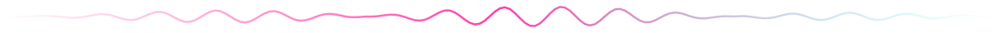
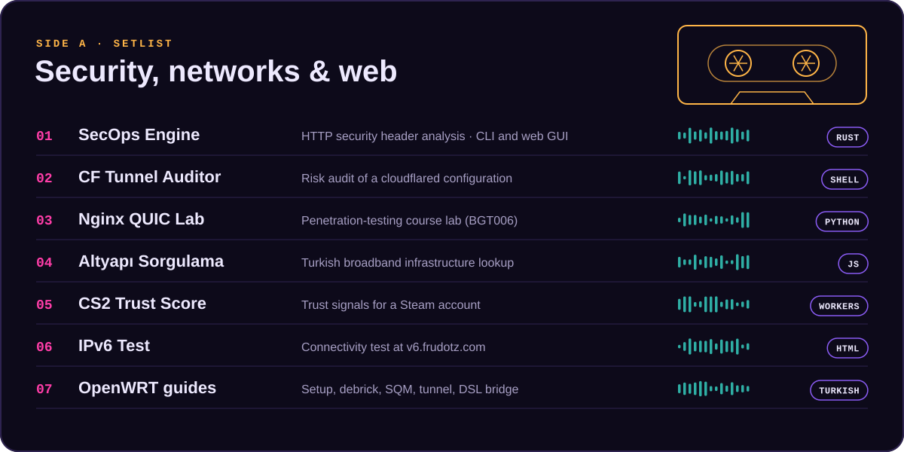
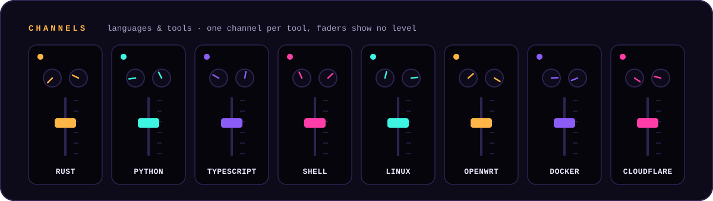
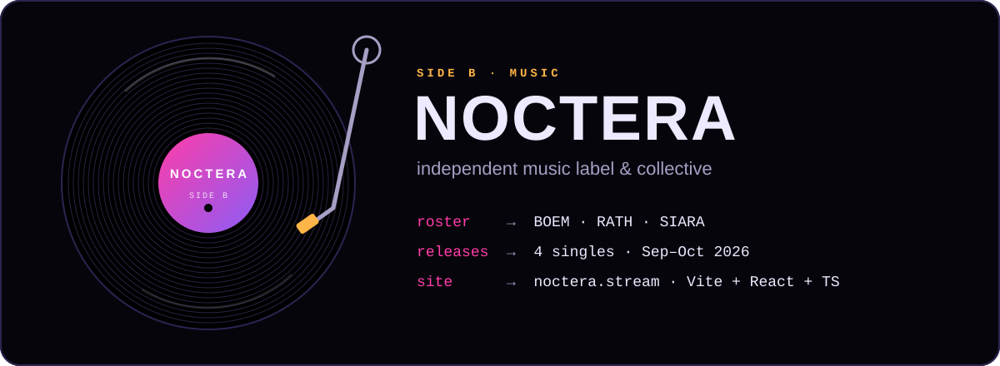

<!--
  OPTION B: "Gece Vardiyası / Night Shift" — cyber-night and music. ENGLISH BACKUP.
  Turkish-first version: README-option-b-gece-vardiyasi-tr.md (same facts, Turkish artwork).
  All artwork is original SVG in ./assets/b-gece (*-en.svg); no external hosts, fonts or scripts.
  Panels are drawn on their own dark background, so they stay legible in GitHub's light theme too.
  The hero cursor and waveform animation lasts under 5 seconds and does not play with "reduce motion".
  Resolve every [[CONFIRM: ...]] marker before this replaces readme.md.
-->

<a href="README-option-b-gece-vardiyasi-tr.md">Türkçe</a> · <b>English</b>

  <b>frudotz</b> · [[CONFIRM: display name, e.g. H. Arda Karabacak]] · Istanbul 
  <a href="https://frudotz.com">frudotz.com</a> ·
  <a href="https://www.linkedin.com/in/frudotz/">LinkedIn</a> ·
  <a href="https://www.behance.net/frudotz">Behance</a> ·
  <a href="https://discord.com/users/460867393141342218">Discord</a> ·
  <a href="https://x.com/frudotz">X</a>

### `Side A` security, networks and web

<code>01</code> <a href="https://github.com/frudotz/ISU-SecOps-Engine">SecOps Engine</a> · <code>02</code> <a href="https://github.com/frudotz/ISU-SecOps-CFTunnelAuditor">CF Tunnel Auditor</a> · <code>03</code> <a href="https://github.com/frudotz/ISU-SecOps-Nginx-RCE">Nginx QUIC Lab</a> · <code>04</code> <a href="https://altyapi.frudotz.com">Altyapı Sorgulama</a> · <code>05</code> <a href="https://cs2.frudotz.com">CS2 Trust Score</a> · <code>06</code> <a href="https://v6.frudotz.com">IPv6 Test</a> · <code>07</code> <a href="https://github.com/frudotz?tab=repositories&q=openwrt">OpenWRT guides</a>

Design tools: [[CONFIRM: e.g. Photoshop / Illustrator / Figma]]

### `Side B` music

`role` [[CONFIRM: your role at NOCTERA: founder / design / web / A&R ?]] · `music` [[CONFIRM: do you make or perform music yourself?]] · [site source](https://github.com/frudotz/noctera-stream)

<table>
  <tr>
    <td><b>day</b></td>
    <td>Advertising, community and brand communications experience (since 2021, remote) [[CONFIRM: may the organisation name and your title be published?]] · Volunteer graphics and social media at İnternet Özgürlüğü Girişimi (since 2025) · Volunteer graphic designer at Nraphy (2021–2024)</td>
  </tr>
  <tr>
    <td><b>night</b></td>
    <td>İstinye University, Information Security Technology associate degree (expected graduation June 2027) · TryHackMe paths, Cisco NetAcad, BTK Akademi</td>
  </tr>
</table>

[[CONFIRM: availability wording, e.g. "Open to design, campaign and junior security roles"]]
