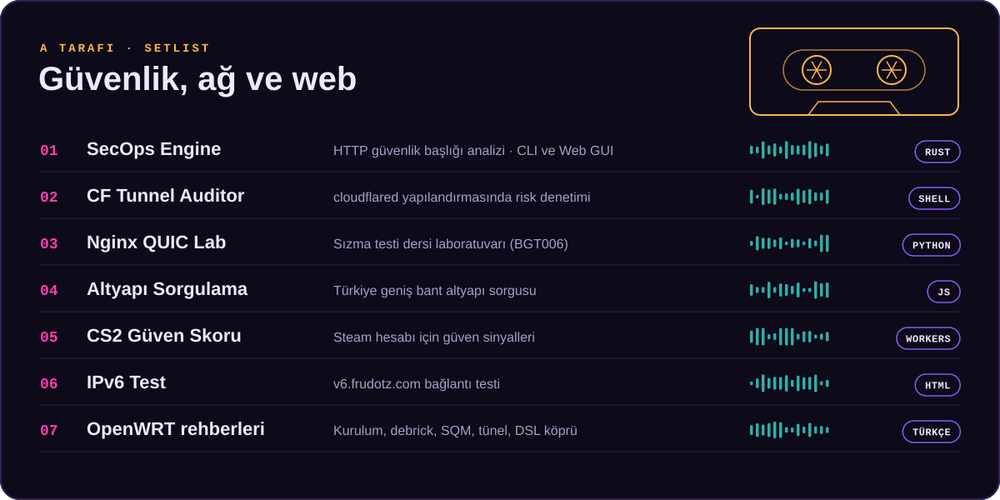
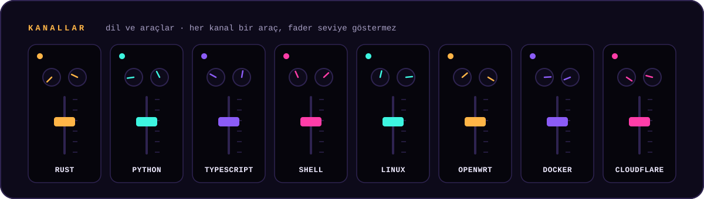
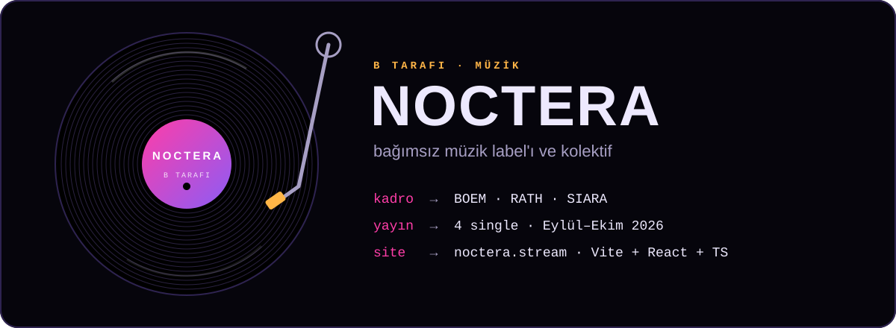

<!--
  SEÇENEK B: "Gece Vardiyası" — cyber-gece ve müzik. Türkçe.
  Tüm görseller ./assets/b-gece altındaki özgün SVG'lerdir; dış sunucu, font ya da script yok.
  Görseller kendi koyu panelleriyle çizildi, böylece açık temada da okunur.
  Hero'daki imleç ve dalga animasyonu 5 saniyeden kısa sürer ve "hareketi azalt" tercihinde hiç oynamaz.
  [[CONFIRM: ...]] işaretleri çözülmeden readme.md yerine konmamalı.
-->

  <b>frudotz</b> · [[CONFIRM: görünen ad, ör. H. Arda Karabacak]] · İstanbul 
  <a href="https://frudotz.com">frudotz.com</a> ·
  <a href="https://www.linkedin.com/in/frudotz/">LinkedIn</a> ·
  <a href="https://www.behance.net/frudotz">Behance</a> ·
  <a href="https://discord.com/users/460867393141342218">Discord</a> ·
  <a href="https://x.com/frudotz">X</a>

### `A tarafı` güvenlik, ağ ve web

<code>01</code> <a href="https://github.com/frudotz/ISU-SecOps-Engine">SecOps Engine</a> · <code>02</code> <a href="https://github.com/frudotz/ISU-SecOps-CFTunnelAuditor">CF Tunnel Auditor</a> · <code>03</code> <a href="https://github.com/frudotz/ISU-SecOps-Nginx-RCE">Nginx QUIC Lab</a> · <code>04</code> <a href="https://altyapi.frudotz.com">Altyapı Sorgulama</a> · <code>05</code> <a href="https://cs2.frudotz.com">CS2 Güven Skoru</a> · <code>06</code> <a href="https://v6.frudotz.com">IPv6 Test</a> · <code>07</code> <a href="https://github.com/frudotz?tab=repositories&q=openwrt">OpenWRT rehberleri</a>

Tasarım araçları: [[CONFIRM: ör. Photoshop / Illustrator / Figma]]

### `B tarafı` müzik

`rol` [[CONFIRM: NOCTERA'daki rolün: kurucu / tasarım / web / A&R ?]] · `müzik` [[CONFIRM: kendin müzik üretiyor veya icra ediyor musun?]] · [site kaynağı](https://github.com/frudotz/noctera-stream)

<table>
  <tr>
    <td><b>gündüz</b></td>
    <td>GIBIRNet'te reklam uzmanı (2021'den beri, uzaktan) · İnternet Özgürlüğü Girişimi'nde gönüllü grafik ve sosyal medya (2025'ten beri) · Nraphy'de gönüllü grafik tasarımcı (2021–2024)</td>
  </tr>
  <tr>
    <td><b>gece</b></td>
    <td>İstinye Üniversitesi, Bilişim Güvenliği Teknolojisi önlisans (beklenen mezuniyet Haziran 2027) · TryHackMe yolları, Cisco NetAcad, BTK Akademi</td>
  </tr>
</table>

[[CONFIRM: uygunluk cümlesi, ör. "Tasarım, kampanya ve junior güvenlik rollerine açığım"]]
