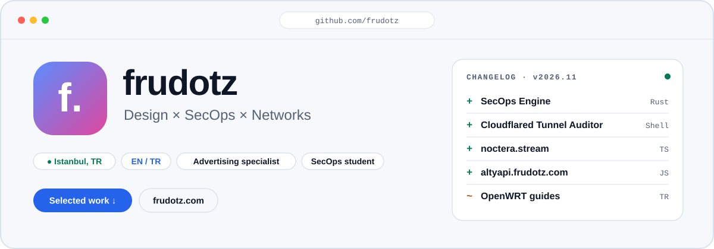
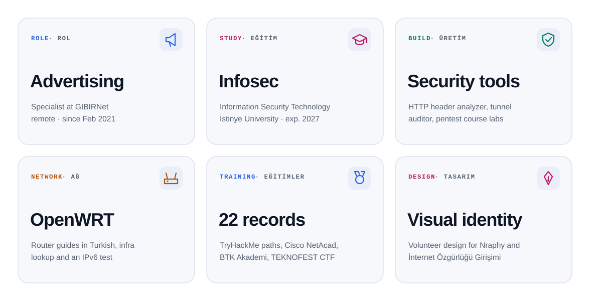
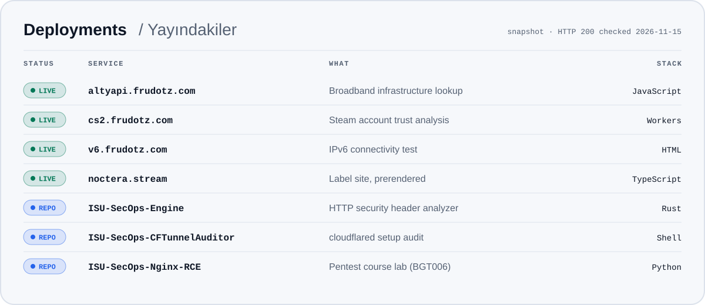

<!--
  OPTION C: "Product dashboard" — modern bilingual (English first, full Turkish below).
  Original SVGs in ./assets/c-dashboard with light and dark variants via <picture>.
  Live widgets (checked 2026-11-15, all HTTP 200): shields.io "website" status pills and one skillicons.dev strip.
  github-readme-stats is deliberately not used (public instance returned 503 on 2026-11-15).
  Resolve every [[CONFIRM: ...]] marker before this replaces readme.md.
-->

<picture>
  <source media="(prefers-color-scheme: dark)" srcset="./assets/c-dashboard/hero-dark.svg">
  <source media="(prefers-color-scheme: light)" srcset="./assets/c-dashboard/hero-light.svg">
  
</picture>

<samp>
<a href="https://frudotz.com">site</a> ·
<a href="https://www.linkedin.com/in/frudotz/">linkedin</a> ·
<a href="https://www.behance.net/frudotz">behance</a> ·
<a href="https://noctera.stream">noctera</a> ·
<a href="https://discord.com/users/460867393141342218">discord</a> ·
<a href="https://x.com/frudotz">x</a>
</samp>

**frudotz** [[CONFIRM: display name]]: designer and advertising specialist, studying information security in Istanbul. I build small, auditable tools for networks and the web.

<picture>
  <source media="(prefers-color-scheme: dark)" srcset="./assets/c-dashboard/bento-dark.svg">
  <source media="(prefers-color-scheme: light)" srcset="./assets/c-dashboard/bento-light.svg">
  
</picture>

### Shipped

<picture>
  <source media="(prefers-color-scheme: dark)" srcset="./assets/c-dashboard/status-board-dark.svg">
  <source media="(prefers-color-scheme: light)" srcset="./assets/c-dashboard/status-board-light.svg">
  
</picture>

  
  
  
  

| Project | What it does |
| :-- | :-- |
| [SecOps Engine](https://github.com/frudotz/ISU-SecOps-Engine) | HTTP security header analyzer, CLI and web GUI (Rust) |
| [CF Tunnel Auditor](https://github.com/frudotz/ISU-SecOps-CFTunnelAuditor) | Audits a cloudflared setup for misconfiguration and exposure (Shell) |
| [Nginx QUIC lab](https://github.com/frudotz/ISU-SecOps-Nginx-RCE) | Penetration-testing course lab, BGT006 (Python) |
| [Altyapı Sorgulama](https://altyapi.frudotz.com) · [CS2 trust](https://cs2.frudotz.com) · [IPv6 test](https://v6.frudotz.com) | Web tools ([source](https://github.com/frudotz/net-infra-query), [source](https://github.com/frudotz/steam-cs2-analytics), [source](https://github.com/frudotz/ipv6-test)) |
| [OpenWRT guides](https://github.com/frudotz?tab=repositories&q=openwrt) | Router setup, debrick, SQM, tunnel, DSL bridge (in Turkish) |
| [noctera.stream](https://noctera.stream) | Site for the label NOCTERA. [[CONFIRM: your role at NOCTERA]] · [[CONFIRM: music involvement]] |

### Stack

<picture>
  <source media="(prefers-color-scheme: dark)" srcset="https://skillicons.dev/icons?i=rust,py,ts,bash,linux,docker,cloudflare,nginx&theme=dark">
  <source media="(prefers-color-scheme: light)" srcset="https://skillicons.dev/icons?i=rust,py,ts,bash,linux,docker,cloudflare,nginx&theme=light">
  
</picture>

Also OpenWRT. Design tools: [[CONFIRM: design tools]]. [[CONFIRM: availability wording]]

<samp>türkçe</samp>

<h3>frudotz [[CONFIRM: görünen ad]]</h3>

İstanbul'da bilişim güvenliği okuyan bir tasarımcı ve reklam uzmanıyım. Ağ ve web için küçük, denetlenebilir araçlar ve Türkçe OpenWRT rehberleri yazıyorum.

- **rol**: GIBIRNet'te reklam uzmanı (Şubat 2021'den beri, uzaktan)
- **eğitim**: İstinye Üniversitesi, Bilişim Güvenliği Teknolojisi önlisans (beklenen Haziran 2027)
- **güvenlik**: [SecOps Engine](https://github.com/frudotz/ISU-SecOps-Engine) · [CF Tunnel Auditor](https://github.com/frudotz/ISU-SecOps-CFTunnelAuditor) · [Nginx QUIC lab](https://github.com/frudotz/ISU-SecOps-Nginx-RCE) (ders laboratuvarı)
- **ağ ve web**: [OpenWRT rehberleri](https://github.com/frudotz?tab=repositories&q=openwrt) · [Altyapı Sorgulama](https://altyapi.frudotz.com) · [IPv6 test](https://v6.frudotz.com) · [CS2 güven analizi](https://cs2.frudotz.com)
- **tasarım**: Nraphy ve İnternet Özgürlüğü Girişimi için gönüllü görsel kimlik çalışmaları · [Behance](https://www.behance.net/frudotz)
- **müzik**: bağımsız label [NOCTERA](https://noctera.stream) için web sitesi · [[CONFIRM: rol]]

