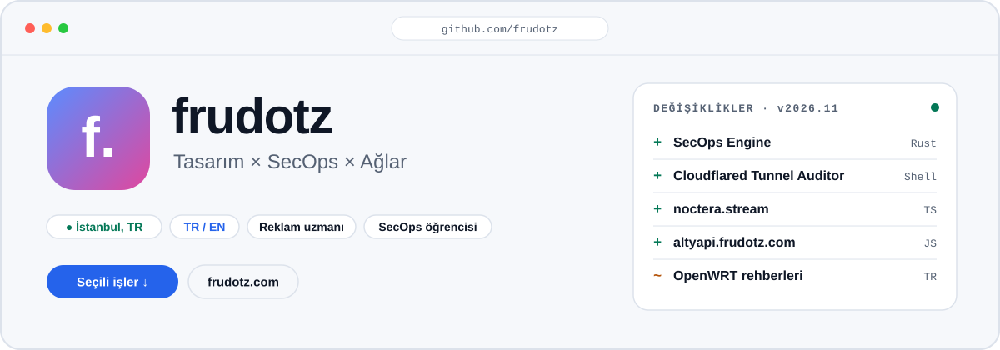
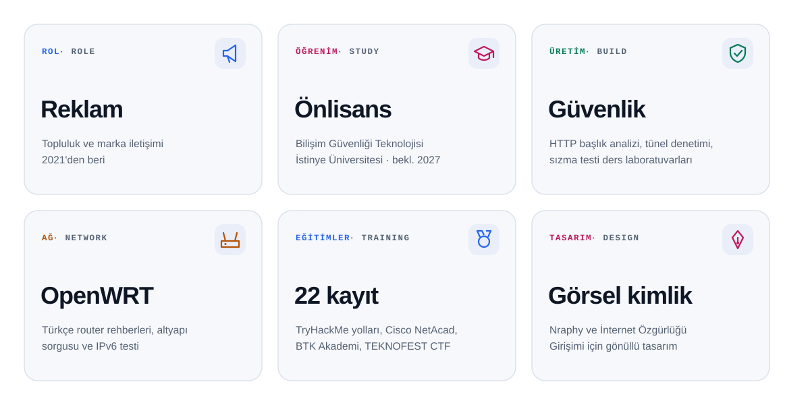
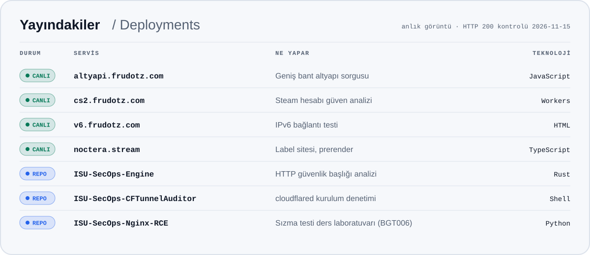

<!--
  SEÇENEK C: "Ürün paneli" — modern, iki dilli. TÜRKÇE ÖNCELİKLİ (Türkçe üstte, kısa İngilizce özet aşağıda katlanır bölümde).
  İngilizce öncelikli iki dilli yedek: README-option-c-dashboard-en.md.
  Özgün SVG'ler ./assets/c-dashboard altında (*-tr.svg), <picture> ile açık ve koyu tema varyantları.
  Canlı bileşenler (2026-11-15'te kontrol edildi, hepsi HTTP 200): shields.io "website" durum rozetleri ve tek bir skillicons.dev şeridi.
  github-readme-stats bilerek kullanılmadı (herkese açık sunucu 2026-11-15'te 503 döndü).
  [[CONFIRM: ...]] işaretleri çözülmeden readme.md yerine konmamalı.
-->

<b>Türkçe</b> · <a href="README-option-c-dashboard-en.md">English + Türkçe</a>

<picture>
  <source media="(prefers-color-scheme: dark)" srcset="./assets/c-dashboard/hero-dark-tr.svg">
  <source media="(prefers-color-scheme: light)" srcset="./assets/c-dashboard/hero-light-tr.svg">
  
</picture>

<samp>
<a href="https://frudotz.com">site</a> ·
<a href="https://www.linkedin.com/in/frudotz/">linkedin</a> ·
<a href="https://www.behance.net/frudotz">behance</a> ·
<a href="https://noctera.stream">noctera</a> ·
<a href="https://discord.com/users/460867393141342218">discord</a> ·
<a href="https://x.com/frudotz">x</a>
</samp>

**frudotz** [[CONFIRM: görünen ad]]: İstanbul'da bilişim güvenliği okuyan bir tasarımcı ve reklam uzmanıyım. Ağ ve web için küçük, denetlenebilir araçlar ve Türkçe OpenWRT rehberleri yazıyorum.

<picture>
  <source media="(prefers-color-scheme: dark)" srcset="./assets/c-dashboard/bento-dark-tr.svg">
  <source media="(prefers-color-scheme: light)" srcset="./assets/c-dashboard/bento-light-tr.svg">
  
</picture>

[[CONFIRM: kurum adı ve unvan herkese açık yazılabilir mi?]]

### Yayındakiler

<picture>
  <source media="(prefers-color-scheme: dark)" srcset="./assets/c-dashboard/status-board-dark-tr.svg">
  <source media="(prefers-color-scheme: light)" srcset="./assets/c-dashboard/status-board-light-tr.svg">
  
</picture>

  
  
  
  

| Proje | Ne yapar |
| :-- | :-- |
| [SecOps Engine](https://github.com/frudotz/ISU-SecOps-Engine) | HTTP güvenlik başlığı analizi, CLI ve web arayüzü (Rust) |
| [CF Tunnel Auditor](https://github.com/frudotz/ISU-SecOps-CFTunnelAuditor) | cloudflared kurulumunu hatalı yapılandırma ve dışa açıklık için denetler (Shell) |
| [Nginx QUIC lab](https://github.com/frudotz/ISU-SecOps-Nginx-RCE) | Sızma testi ders laboratuvarı, BGT006 (Python) |
| [Altyapı Sorgulama](https://altyapi.frudotz.com) · [CS2 güven analizi](https://cs2.frudotz.com) · [IPv6 testi](https://v6.frudotz.com) | Web araçları ([kaynak](https://github.com/frudotz/net-infra-query), [kaynak](https://github.com/frudotz/steam-cs2-analytics), [kaynak](https://github.com/frudotz/ipv6-test)) |
| [OpenWRT rehberleri](https://github.com/frudotz?tab=repositories&q=openwrt) | Router kurulumu, debrick, SQM, tünel, DSL köprü (Türkçe) |
| [noctera.stream](https://noctera.stream) | NOCTERA label'ının herkese açık sitesi ([kaynak](https://github.com/frudotz/noctera-stream)). [[CONFIRM: NOCTERA'daki rolün]] · [[CONFIRM: müzikle ilişkin]] |

### Teknolojiler

<picture>
  <source media="(prefers-color-scheme: dark)" srcset="https://skillicons.dev/icons?i=rust,py,ts,bash,linux,docker,cloudflare,nginx&theme=dark">
  <source media="(prefers-color-scheme: light)" srcset="https://skillicons.dev/icons?i=rust,py,ts,bash,linux,docker,cloudflare,nginx&theme=light">
  
</picture>

Ayrıca OpenWRT. Tasarım araçları: [[CONFIRM: tasarım araçları]]. [[CONFIRM: uygunluk cümlesi]]

<samp>english</samp>

<h3>frudotz [[CONFIRM: display name]]</h3>

Designer and advertising specialist, studying information security in Istanbul. I build small, auditable tools for networks and the web, and write OpenWRT guides in Turkish.

- **role**: advertising, community and brand communications experience since 2021 (remote) · [[CONFIRM: may the organisation name and your title be published?]]
- **study**: İstinye University, Information Security Technology associate degree (expected June 2027)
- **security**: [SecOps Engine](https://github.com/frudotz/ISU-SecOps-Engine) · [CF Tunnel Auditor](https://github.com/frudotz/ISU-SecOps-CFTunnelAuditor) · [Nginx QUIC lab](https://github.com/frudotz/ISU-SecOps-Nginx-RCE) (course lab)
- **network & web**: [OpenWRT guides](https://github.com/frudotz?tab=repositories&q=openwrt) · [Altyapı Sorgulama](https://altyapi.frudotz.com) · [IPv6 test](https://v6.frudotz.com) · [CS2 trust analysis](https://cs2.frudotz.com)
- **design**: volunteer visual identity work for Nraphy and İnternet Özgürlüğü Girişimi · [Behance](https://www.behance.net/frudotz)
- **music**: website for the independent label [NOCTERA](https://noctera.stream) · [[CONFIRM: your role at NOCTERA]] · [[CONFIRM: music involvement]]
- **other**: design tools [[CONFIRM: design tools]] · [[CONFIRM: availability wording]]

