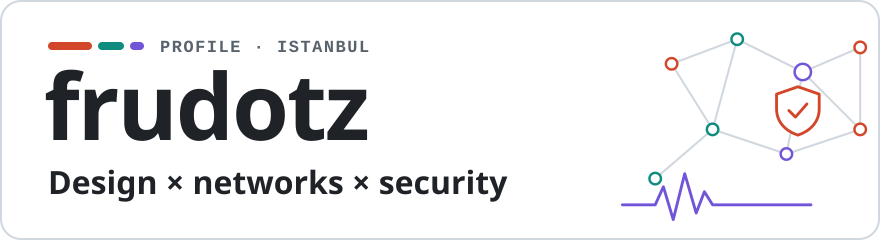
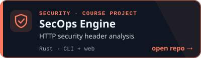
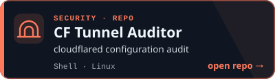
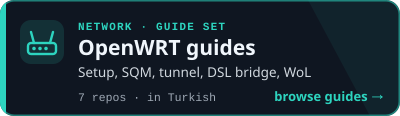
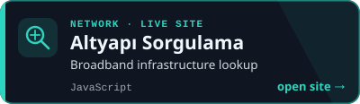
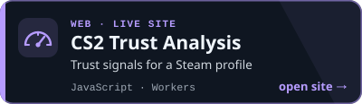
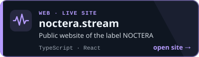

<!--
  OPTION D: "Profile summary" — RECOMMENDED DIRECTION. ENGLISH (backup of the Turkish primary).
  Turkish primary: README-option-d-profile-summary-tr.md (same facts, Turkish artwork).
  Information architecture: short identity summary → evidence-backed capability groups → categorised image buttons → compact background.
  All artwork is original SVG under ./assets/d-profile (*-en.svg); no external hosts, fonts, scripts or remote images.
  Do not replace readme.md until the [[CONFIRM: ...]] markers are resolved.
-->

<a href="README-option-d-profile-summary-tr.md">Türkçe</a> · <b>English</b>

<a href="https://frudotz.com">
  <picture>
    <source media="(prefers-color-scheme: dark)" srcset="./assets/d-profile/hero-dark-en.svg">
    <source media="(prefers-color-scheme: light)" srcset="./assets/d-profile/hero-light-en.svg">
    
  </picture>
</a>

  <b>frudotz</b> · [[CONFIRM: display name]] · Istanbul 
  <a href="https://frudotz.com">frudotz.com</a> ·
  <a href="https://www.linkedin.com/in/frudotz/">LinkedIn</a> ·
  <a href="https://www.behance.net/frudotz">Behance</a> ·
  <a href="https://discord.com/users/460867393141342218">Discord</a> ·
  <a href="https://x.com/frudotz">X</a>

**I come from design and brand communications, study information security, and build small, auditable tools for networks and the web.**

I've worked in advertising, community and brand communications since 2021, and I'm studying Information Security Technology at İstinye University. My GitHub sits where the two meet: tools that audit HTTP headers and tunnel configurations, OpenWRT guides written in Turkish, a few live web tools, and the public website of the label NOCTERA.

## What I work on

<table>
  <tr>
    <td width="50%" valign="top">
      <b>Security</b> 
      <b>Building:</b> HTTP security header analysis (CLI + web), cloudflared tunnel configuration audit 
      <b>Course lab:</b> Nginx QUIC penetration testing environment (BGT006) 
      <b>Learning:</b> TryHackMe Jr Penetration Tester path, Cisco NetAcad Introduction to Cybersecurity 
      <code>Rust</code> <code>Shell</code> <code>Python</code> <code>Docker</code>
    </td>
    <td width="50%" valign="top">
      <b>Networks</b> 
      <b>Writing:</b> OpenWRT guides for setup, debricking, SQM, Cloudflare Tunnel, DSL bridging and Wake-on-LAN 
      <b>Live:</b> a broadband infrastructure lookup and an IPv6 test page 
      <b>Learning:</b> BTK Akademi network fundamentals and IPv6 transition courses 
      <code>OpenWRT</code> <code>Linux</code> <code>Cloudflare</code> <code>IPv6</code>
    </td>
  </tr>
  <tr>
    <td width="50%" valign="top">
      <b>Web</b> 
      <b>Live:</b> small tools on static hosting and Cloudflare Workers 
      <b>Web for music:</b> the public website and source code for the label NOCTERA 
      <code>JavaScript</code> <code>TypeScript</code> <code>React</code> <code>Vite</code>
    </td>
    <td width="50%" valign="top">
      <b>Design and communications</b> 
      <b>Experience:</b> advertising, community and brand communications since 2021 
      <b>Volunteer:</b> visual design and social media for Nraphy and İnternet Özgürlüğü Girişimi 
      <b>Portfolio:</b> <a href="https://www.behance.net/frudotz">Behance</a> 
      [[CONFIRM: design tools, e.g. Photoshop / Illustrator / Figma]]
    </td>
  </tr>
</table>

## Selected projects

Each button opens a repository or a live site. Three categories, two pieces of work each.

**Security** · tools that audit

 

**Networks** · guides and lookup tools

 

**Web** · live sites

 

Source: <a href="https://github.com/frudotz/net-infra-query">altyapi</a> · <a href="https://github.com/frudotz/steam-cs2-analytics">cs2</a> · <a href="https://github.com/frudotz/noctera-stream">noctera-stream</a> · Also: <a href="https://github.com/frudotz/debrick-xiaomi-ax3200">AX3200 debrick guide</a> · <a href="https://github.com/frudotz/ISU-SecOps-Nginx-RCE">Nginx QUIC lab</a> (course lab) · <a href="https://v6.frudotz.com">IPv6 test</a> (<a href="https://github.com/frudotz/ipv6-test">source</a>) 
NOCTERA: [[CONFIRM: your role at NOCTERA]] · [[CONFIRM: do you produce or perform music yourself?]]

## Background

| **Study** | İstinye University, Information Security Technology associate degree (expected June 2027) |
| :-- | :-- |
| **Experience** | Advertising, community and brand communications since 2021 (remote) · [[CONFIRM: may the organisation name and your title be published?]] |
| **Training** | TryHackMe learning paths · Cisco Networking Academy · BTK Akademi · TEKNOFEST SiberVatan AyaküstüCTF (participant) |

Training details

- TryHackMe learning paths: Jr Penetration Tester, CompTIA Pentest+ <i>path</i>, Complete Beginner, Pre Security, Web Fundamentals
- Cisco Networking Academy: Introduction to Cybersecurity
- BTK Akademi: Ağ Temelleri (Network Fundamentals), IPV6 Teknoloji Dönüşüm İhtiyaçları ve Çalışmaları (IPv6 transition)
- TEKNOFEST SiberVatan AyaküstüCTF: participant

[[CONFIRM: availability wording, e.g. "Open to design, campaign and junior security roles"]]
