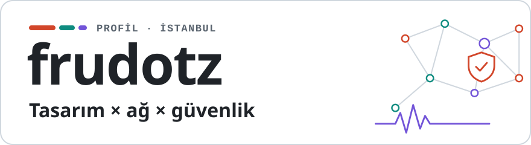
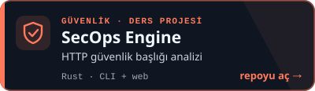
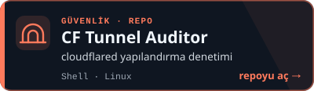
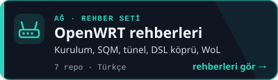
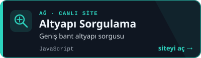
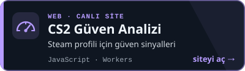
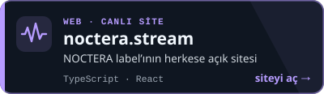

<!--
  SEÇENEK D: "Profil özeti" — ÖNERİLEN YÖN. TÜRKÇE (ana sürüm).
  İngilizce yedek: README-option-d-profile-summary-en.md (aynı olgular, İngilizce görseller).
  Bilgi mimarisi: kısa kimlik özeti → kanıta bağlı yetkinlik grupları → kategorili, görselli proje butonları → kısa arka plan.
  Tüm görseller ./assets/d-profile altındaki özgün SVG'lerdir (*-tr.svg); dış sunucu, font, script ya da harici görsel yok.
  [[CONFIRM: ...]] işaretleri çözülmeden readme.md yerine konmamalı.
-->

<b>Türkçe</b> · <a href="README-option-d-profile-summary-en.md">English</a>

<a href="https://frudotz.com">
  <picture>
    <source media="(prefers-color-scheme: dark)" srcset="./assets/d-profile/hero-dark-tr.svg">
    <source media="(prefers-color-scheme: light)" srcset="./assets/d-profile/hero-light-tr.svg">
    
  </picture>
</a>

  <b>frudotz</b> · [[CONFIRM: görünen ad]] · İstanbul 
  <a href="https://frudotz.com">frudotz.com</a> ·
  <a href="https://www.linkedin.com/in/frudotz/">LinkedIn</a> ·
  <a href="https://www.behance.net/frudotz">Behance</a> ·
  <a href="https://discord.com/users/460867393141342218">Discord</a> ·
  <a href="https://x.com/frudotz">X</a>

**Tasarım ve marka iletişiminden gelen, bilişim güvenliği okuyan biriyim; ağ ve web için küçük, denetlenebilir araçlar yazıyorum.**

2021'den beri reklam, topluluk ve marka iletişimi tarafında çalışıyorum; İstinye Üniversitesi'nde Bilişim Güvenliği Teknolojisi okuyorum. GitHub'da bu iki tarafın kesiştiği yerde duruyorum: HTTP başlıklarını ve tünel yapılandırmalarını denetleyen araçlar, Türkçe OpenWRT rehberleri, birkaç canlı web aracı ve NOCTERA label'ının herkese açık sitesi.

## Neler üzerinde çalışıyorum

<table>
  <tr>
    <td width="50%" valign="top">
      <b>Güvenlik</b> 
      <b>Üretiyorum:</b> HTTP güvenlik başlığı analizi (CLI + web), cloudflared tünel yapılandırma denetimi 
      <b>Ders laboratuvarı:</b> Nginx QUIC sızma testi ortamı (BGT006) 
      <b>Öğreniyorum:</b> TryHackMe Jr Penetration Tester yolu, Cisco NetAcad Introduction to Cybersecurity 
      <code>Rust</code> <code>Shell</code> <code>Python</code> <code>Docker</code>
    </td>
    <td width="50%" valign="top">
      <b>Ağ</b> 
      <b>Yazıyorum:</b> OpenWRT kurulum, debrick, SQM, Cloudflare Tunnel, DSL köprü ve Wake-on-LAN rehberleri 
      <b>Yayında:</b> geniş bant altyapı sorgusu ve IPv6 test sayfası 
      <b>Öğreniyorum:</b> BTK Akademi Ağ Temelleri, IPv6 dönüşümü 
      <code>OpenWRT</code> <code>Linux</code> <code>Cloudflare</code> <code>IPv6</code>
    </td>
  </tr>
  <tr>
    <td width="50%" valign="top">
      <b>Web</b> 
      <b>Yayında:</b> statik siteler ve Cloudflare Workers üzerinde küçük araçlar 
      <b>Müzik için web:</b> NOCTERA label'ının herkese açık sitesi ve kaynak kodu 
      <code>JavaScript</code> <code>TypeScript</code> <code>React</code> <code>Vite</code>
    </td>
    <td width="50%" valign="top">
      <b>Tasarım ve iletişim</b> 
      <b>Deneyim:</b> 2021'den beri reklam, topluluk ve marka iletişimi 
      <b>Gönüllü:</b> Nraphy ve İnternet Özgürlüğü Girişimi için görsel tasarım ve sosyal medya 
      <b>Portfolyo:</b> <a href="https://www.behance.net/frudotz">Behance</a> 
      [[CONFIRM: tasarım araçları, ör. Photoshop / Illustrator / Figma]]
    </td>
  </tr>
</table>

## Seçili projeler

Her buton bir repoya ya da canlı siteye gider. Üç kategori, kategori başına iki iş.

**Güvenlik** · denetleyen araçlar

 

**Ağ** · rehberler ve sorgu araçları

 

**Web** · canlı siteler

 

Kaynak kod: <a href="https://github.com/frudotz/net-infra-query">altyapi</a> · <a href="https://github.com/frudotz/steam-cs2-analytics">cs2</a> · <a href="https://github.com/frudotz/noctera-stream">noctera-stream</a> · Ayrıca: <a href="https://github.com/frudotz/debrick-xiaomi-ax3200">AX3200 debrick rehberi</a> · <a href="https://github.com/frudotz/ISU-SecOps-Nginx-RCE">Nginx QUIC lab</a> (ders laboratuvarı) · <a href="https://v6.frudotz.com">IPv6 testi</a> (<a href="https://github.com/frudotz/ipv6-test">kaynak</a>) 
NOCTERA: [[CONFIRM: NOCTERA'daki rolün]] · [[CONFIRM: kendin müzik üretiyor veya icra ediyor musun?]]

## Arka plan

| **Öğrenim** | İstinye Üniversitesi, Bilişim Güvenliği Teknolojisi önlisans (beklenen: Haziran 2027) |
| :-- | :-- |
| **Deneyim** | 2021'den beri reklam, topluluk ve marka iletişimi (uzaktan) · [[CONFIRM: kurum adı ve unvan herkese açık yazılabilir mi?]] |
| **Eğitimler** | TryHackMe öğrenme yolları · Cisco Networking Academy · BTK Akademi · TEKNOFEST SiberVatan AyaküstüCTF (katılımcı) |

Eğitimlerin ayrıntısı

- TryHackMe öğrenme yolları: Jr Penetration Tester, CompTIA Pentest+ <i>yolu</i>, Complete Beginner, Pre Security, Web Fundamentals
- Cisco Networking Academy: Introduction to Cybersecurity
- BTK Akademi: Ağ Temelleri, IPV6 Teknoloji Dönüşüm İhtiyaçları ve Çalışmaları
- TEKNOFEST SiberVatan AyaküstüCTF: katılımcı

[[CONFIRM: uygunluk cümlesi, ör. "Tasarım, kampanya ve junior güvenlik rollerine açığım"]]
