
<b>Türkçe</b> · <a href="README.en.md">English</a>

<a href="https://frudotz.com">
  <picture>
    <source media="(prefers-color-scheme: dark)" srcset="./assets/a-studio/hero-dark-tr.svg">
    <source media="(prefers-color-scheme: light)" srcset="./assets/a-studio/hero-light-tr.svg">
    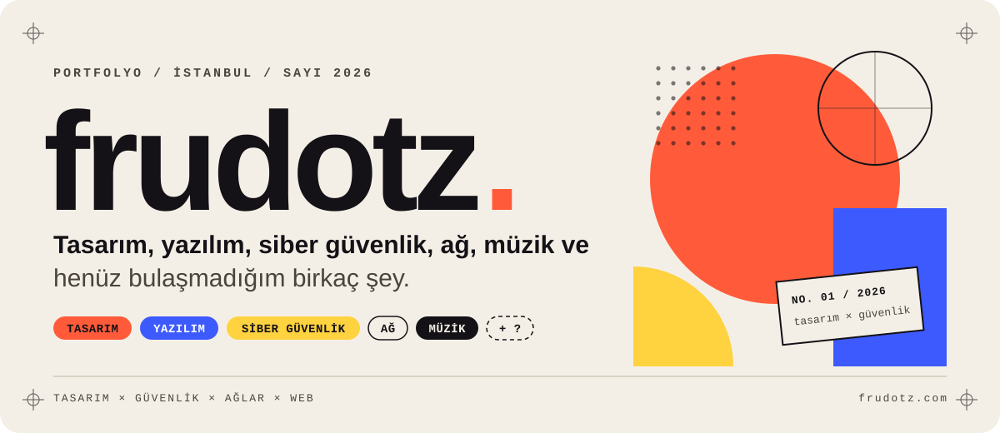
  </picture>
</a>

  <b>frudotz</b> · İstanbul 
  <a href="https://frudotz.com">frudotz.com</a> ·
  <a href="https://github.com/frudotz?tab=repositories">GitHub repoları</a> ·
  <a href="https://www.behance.net/frudotz">Behance</a> ·
  <a href="https://www.linkedin.com/in/frudotz/">LinkedIn</a> ·
  <a href="https://www.instagram.com/frudotz/">Instagram</a>

**Tasarımcı gözüyle güvenlik ve ağ araçları yapıyorum.** HTTP başlıklarını ve tünel yapılandırmalarını denetleyen küçük araçlar, Türkçe OpenWRT rehberleri ve birkaç web projesi; hepsi aşağıdaki herkese açık GitHub repolarında.

**Araçlar** `Rust` `Python` `Shell` `JavaScript` `TypeScript` `React` `Vite` `Docker` `Cloudflare Workers` `Cloudflare Tunnel` `OpenWRT` `Linux`

## Neler üzerinde çalışıyorum

Her kart ilgili GitHub reposunu açar.

<a href="https://github.com/frudotz/anafor-mcp">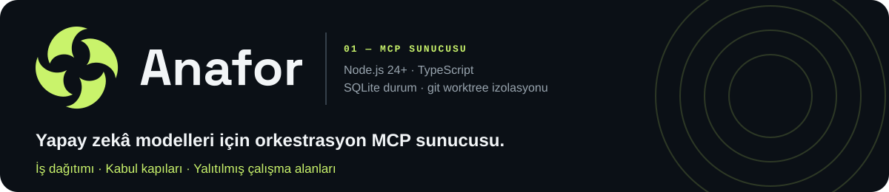</a>

<a href="https://github.com/frudotz?tab=repositories&q=openwrt">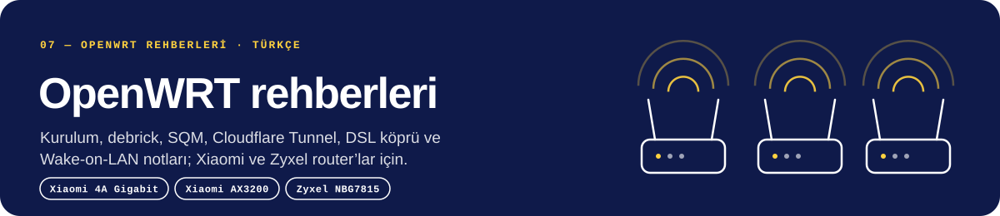</a>

OpenWRT rehber repoları: <a href="https://github.com/frudotz/openwrt-xiaomi-4a-gigabit">4A Gigabit</a> · <a href="https://github.com/frudotz/openwrt-xiaomi-ax3200">AX3200</a> · <a href="https://github.com/frudotz/debrick-xiaomi-ax3200">AX3200 debrick</a> · <a href="https://github.com/frudotz/openwrt-zyxel-nbg7815">NBG7815</a> · <a href="https://github.com/frudotz/openwrt-sqm">SQM</a> · <a href="https://github.com/frudotz/openwrt-cloudflare-tunnel">Cloudflare Tunnel</a> · <a href="https://github.com/frudotz/openwrt-dsl-bridge-wizard">DSL köprü</a> · <a href="https://github.com/frudotz/openwrt-wol-automation">Wake-on-LAN</a>

<table>
  <tr><td width="50%"><a href="https://github.com/frudotz/net-infra-query">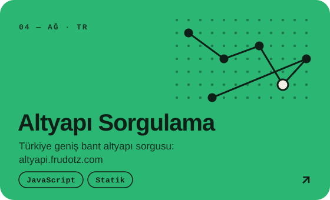</a></td><td width="50%"><a href="https://github.com/frudotz/steam-cs2-analytics">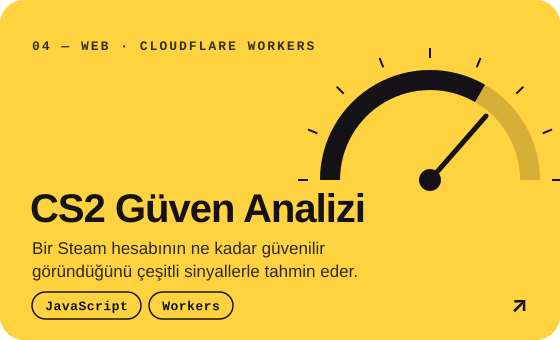</a></td></tr>
  <tr><td width="50%"><a href="https://github.com/frudotz/ISU-SecOps-Nginx-RCE">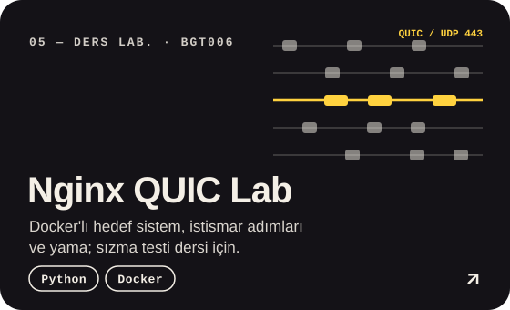</a></td><td width="50%"><a href="https://github.com/frudotz/ISU-SecOps-CFTunnelAuditor">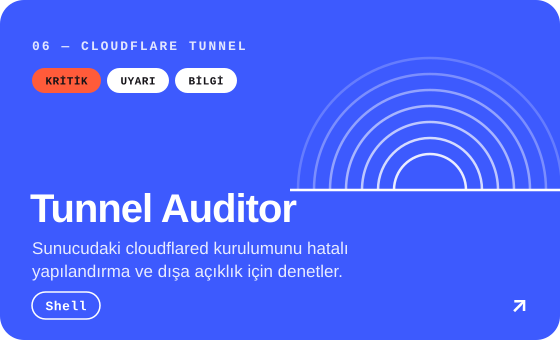</a></td></tr>
  <tr><td width="50%"><a href="https://github.com/frudotz/ISU-SecOps-Engine">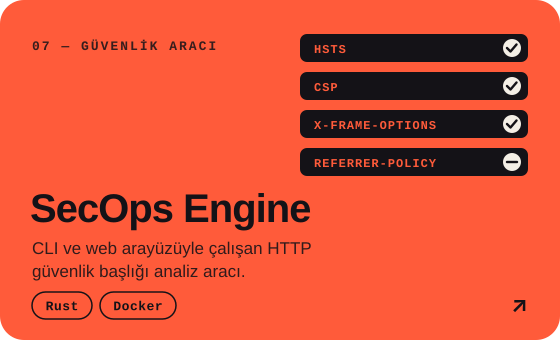</a></td><td width="50%"><a href="https://github.com/frudotz/noctera-stream">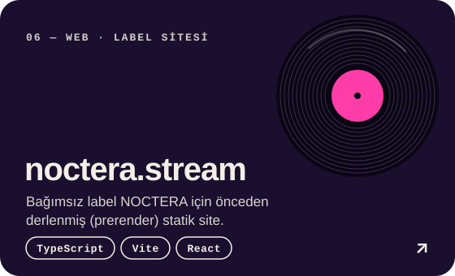</a></td></tr>
</table>

## Katkı etkinliği

<picture>
  <source media="(prefers-color-scheme: dark)" srcset="./assets/a-studio/stats-dark-tr.svg">
  <source media="(prefers-color-scheme: light)" srcset="./assets/a-studio/stats-light-tr.svg">
  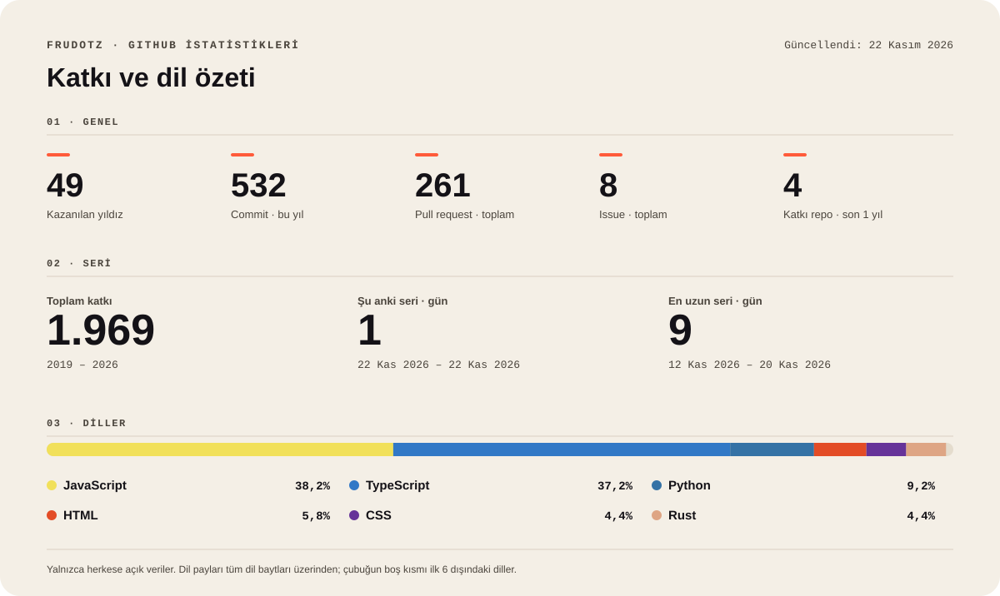
</picture>

<picture>
  <source media="(prefers-color-scheme: dark)" srcset="./assets/a-studio/contrib-dark-tr.svg">
  <source media="(prefers-color-scheme: light)" srcset="./assets/a-studio/contrib-light-tr.svg">
  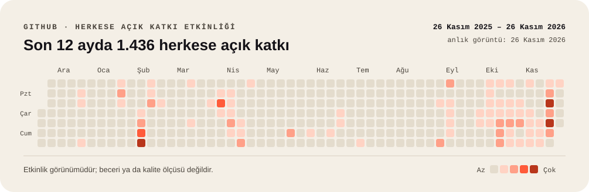
</picture>

Kaynak: <a href="https://github.com/frudotz">GitHub profilindeki</a> herkese açık veriler. Görseller yerel ve özgündür; her gece bir GitHub Action ile yeniden üretilir.

